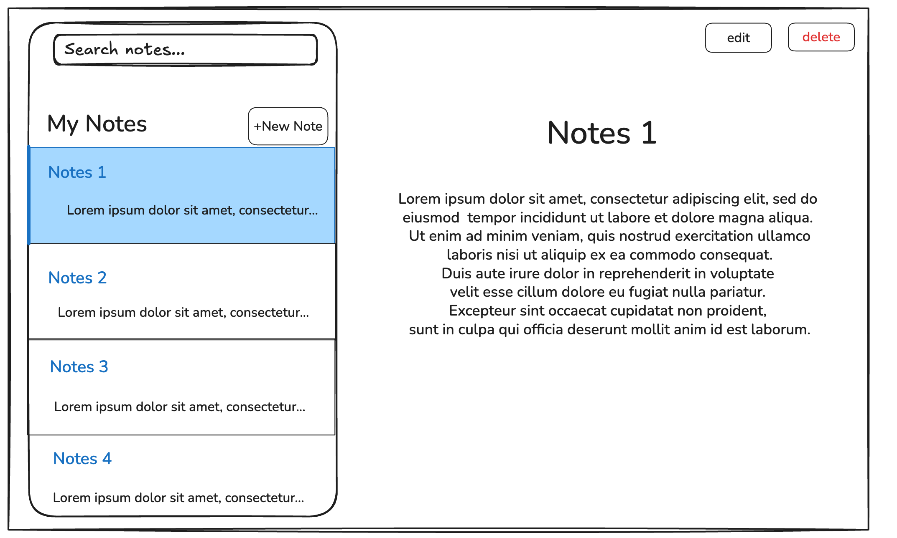

# DevCollab

A collaborative knowledge base for small teams. Projects hold folders, folders hold notes, and notes support rich text and per-project access control. Built as a portfolio piece to exercise a realistic full-stack setup end to end: auth, relational data modelling, a typed client/server contract, and a deployable build.

## What it does

- Sign up, log in, and stay signed in with HTTPOnly cookie sessions
- Create teams with admin and member roles — only admins can manage users, projects, and folders
- Organise work into projects, folders, and notes
- Share projects with selected team members
- Write notes with a Tiptap rich-text editor (lists, headings, code, links, task checkboxes)
- Server-side input validation and HTML sanitisation on every write

## Why it exists

The app was started as a means to practice Express and SQL properly. The hierarchy (teams → projects → folders → notes), shared-project membership, and role-based permissions exist so the schema actually demands relational fetches, cascading deletes, and join-table membership instead of the usual flat tutorial models.

## Tech stack

**Frontend**
React 19, React Router 7, TanStack Query 5, Tailwind CSS 4, Tiptap 3, Axios, TypeScript, Vite. End-to-end tests with Playwright.

**Backend**
Express 5, TypeScript (strict), Prisma 6 on PostgreSQL (Supabase), JWT auth, bcrypt, Helmet, Morgan, DOMPurify.

**Shared**
A `contract` workspace package exports the types, role enums, and length limits used by both sides, so the API and the UI cannot drift apart.

**Hosting**
Backend on Railway, frontend on Vercel — each configured to build from the monorepo root so the shared `contract` package resolves through npm workspaces. A Railway cron service runs twice a week to delete demo teams older than 7 days.

## Architecture highlights

- **Single source of truth for shapes and limits.** All DTOs, role strings, and `LIMITS` constants live in `@shared/contract`. The frontend and backend both depend on it via npm workspaces, so changing a max-length is one edit instead of three.
- **Cookie-based JWT.** Tokens live in an HTTPOnly `session` cookie with a 7-day expiry. The frontend never touches the token directly, which keeps it out of `localStorage` and out of XSS reach. `sameSite` flips between `strict` (dev) and `none` (prod) to support the cross-origin Railway/Vercel setup.
- **Authorisation in two places.** The backend is the real gate — `adminOnly` middleware protects admin routes and every query is scoped by `teamId` from the JWT. The frontend mirrors this at the route and form level so non-admins are redirected before submitting requests they would only get a 403 from anyway.
- **Unsaved-changes guard.** A custom `useUnsavedChanges` hook combines React Router's `useBlocker` for in-app navigation with a `beforeunload` listener for tab close and refresh. An `allowNav` escape hatch lets the app bypass the guard programmatically after a successful save, so users get a confirm dialog when they would lose work but never see one mid-flow.
- **Two layers of state on the client.** React Context handles session and UI state. TanStack Query owns everything that comes from the server, with a 5-minute stale time and manual cache updates via `setQueryData` for frequent operations like note creation.
- **Defence in depth on writes.** Every input is length-checked against the shared `LIMITS` and rich-text bodies pass through DOMPurify with a Tiptap-aware tag allowlist before they reach Prisma.
- **Cascade rules modelled in the schema.** Deleting a Team, Project, or Folder cascades to its children; deleting a User nulls the related foreign keys on notes so authored content survives.

## Notable problems solved

- **Tiptap undo/redo history bleeding across notes.** Switching notes preserved the previous note's editor history, letting Ctrl+Z restore content from a different document. Fixed by passing `[noteId]` as a `useEditor` dependency so the editor instance is recreated on note switch.
- **DOMPurify stripping Tiptap task list attributes.** The backend sanitiser was removing the `data-type="taskList"` attribute Tiptap relies on, which broke the round-trip between save and reload. The allowlist had to be widened to preserve Tiptap's data attributes.
- **bfcache restoring a logged-out session.** After logout, hitting the back button restored the page from bfcache with the old auth state intact. Fixed with a `pageshow` event listener that re-verifies auth when the page is restored from cache, plus `queryClient.clear()` on logout to prevent cross-user cache leakage.

## Project structure

```
devcollab/
├── frontend/   React + Vite client
├── backend/    Express API + Prisma
└── contract/   Shared TypeScript types and constants
```

Managed as npm workspaces from the root.

## Running locally

Requires Node 18+ and a PostgreSQL database (a free Supabase project works).

```bash
git clone https://github.com/MikeCris89/devcollab.git
cd devcollab
npm install
```

Create `backend/.env`:

```
JWT_SECRET=some-long-random-string
DATABASE_URL=postgresql://...
PUBLIC_URL=http://localhost:5173
```

Apply the schema and start everything:

```bash
npx prisma migrate dev --schema backend/prisma/schema.prisma
npm run dev
```

The root `dev` script runs the backend, frontend, and the contract watcher concurrently.

## Tests

```bash
cd frontend
npx playwright test
```

## Data model



Generated automatically from `backend/prisma/schema.prisma` via `prisma-erd-generator`.

## Wireframe



## Status

Active portfolio project. Core CRUD, auth, sharing, and rich-text editing are in place. Next up: a notification feed so team members are alerted when notes they have access to are created or edited.

## About

Built by Michael Cristofaro as part of a portfolio focused on realistic full-stack work rather than tutorial scaffolding.
